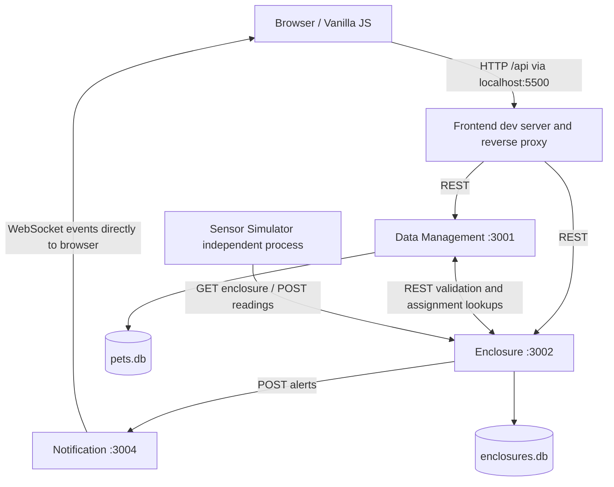
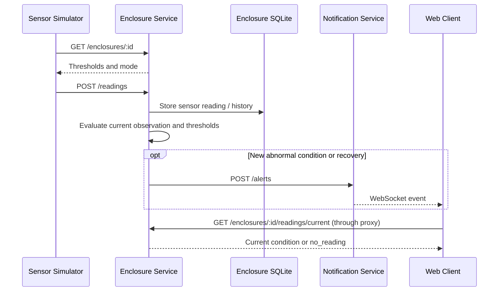

# Exotic Pet Keeper — Implemented Architecture

**Source of truth:** repository service entry points and frontend proxy, snapshot of 16 November 2026.

## Overview

Exotic Pet Keeper is a locally operated, distributed Node.js application composed of three HTTP backend services plus an independently running Sensor Simulator. The fourth process is a producer/client, not an HTTP server; the lecturer's interpretation of the minimum four-microservices requirement should be confirmed before submission.

## Components and responsibility boundaries

| Component | Executable | Port | Responsibilities and persistence |
| --- | --- | --- | --- |
| Data Management | `services/data-management/src/server.js` | 3001 | Animals, feeding groups and records, animal events, enclosure-change events, read-only exports; SQLite `data/pets.db` |
| Enclosure | `services/enclosure/src/server.js` | 3002 | Enclosures, limits, featured animal, monitoring mode, current/latest readings and reading history; SQLite `data/enclosures.db` |
| Notification | `services/notification/src/server.js` | 3004 | Accepts alerts and broadcasts them to connected WebSocket clients; no database |
| Sensor Simulator | `services/sensor/src/index.js` | none | Polls a configured enclosure and submits repeatable simulated readings; no database |
| Frontend server | `frontend/dev-server.js` | 5500, loopback | Serves frontend assets and routes REST calls; not a fourth backend microservice |

## Communication

- **Browser ↔ API:** HTTP via the frontend proxy. Pets, feedings, groups and `GET /enclosures/:id/pets` route to Data Management; the other `/enclosures` endpoints route to Enclosure.
- **Data Management → Enclosure:** HTTP validation when assigning a pet to an enclosure, and best-effort enclosure-name lookup for recorded changes.
- **Enclosure → Data Management:** HTTP checks for assigned animals before certain enclosure changes/deletion and when selecting a featured animal.
- **Sensor → Enclosure:** HTTP `GET /enclosures/:id` followed by `POST /readings`. Default ID is 1 unless `ENCLOSURE_ID` is configured; default interval is 5000 ms (`SENSOR_INTERVAL_MS`).
- **Enclosure → Notification:** HTTP `POST /alerts` when an evaluated reading causes an alert or recovery event.
- **Notification → browser:** direct WebSocket connection at `ws://localhost:3004`, delivering transient alert messages; the frontend reconnects and checks current conditions.

### Example monitoring sequence

## Monitoring and data semantics

Each enclosure can be in `automatic` or `manual` monitoring mode. Sensor readings and manually entered observations are recorded with different sources; current reading selection respects the active mode and the history boundary established when the mode changes. Historical readings are queryable independently from the current snapshot.

An abnormal condition means a temperature/humidity value was outside the configured enclosure range; it is **not** a veterinary diagnosis. WebSocket delivery is best-effort, not a durable queue or source of archived alert history.

Animal event types are `molting`, `weight`, `length`, `behavior`, `health`, `husbandry`, and `other`. Data Management also records discrete enclosure assignment changes. Those changes cannot reconstruct complete historical occupancy; accordingly, PDF/CSV animal exports do not infer per-animal enclosure sensor measurements.

## Data ownership and consistency

- `pets.db`: animals, feeding records, feeding groups/membership, animal events and enclosure-change records.
- `enclosures.db`: enclosure definitions, latest readings and reading history.
- The code enables SQLite foreign-key checks within each service. Cross-service enclosure identifiers are resolved/validated by HTTP, not by SQLite foreign keys across databases.
- Both services create or migrate tables on startup; **never replace an active database** during demonstration setup.
- Active `.db` files are Git-ignored and not included in source archives. The fictional demonstration dataset cannot be reproduced from this snapshot alone.

## Deployment assumptions and limitations

All inter-service addresses/ports are presently hardcoded to localhost. The frontend development server binds to `127.0.0.1` and does not provide cross-device or hosted access. No login, user-specific authorization, HTTPS gateway, Docker configuration, hardware integration or offline/PWA support is implemented. Do not expose these unauthenticated services to the public internet. No automated test suite is included in this snapshot.

See [API reference](api-design.md), [setup](setup-and-demo.md) and [project description](project-description.md).
