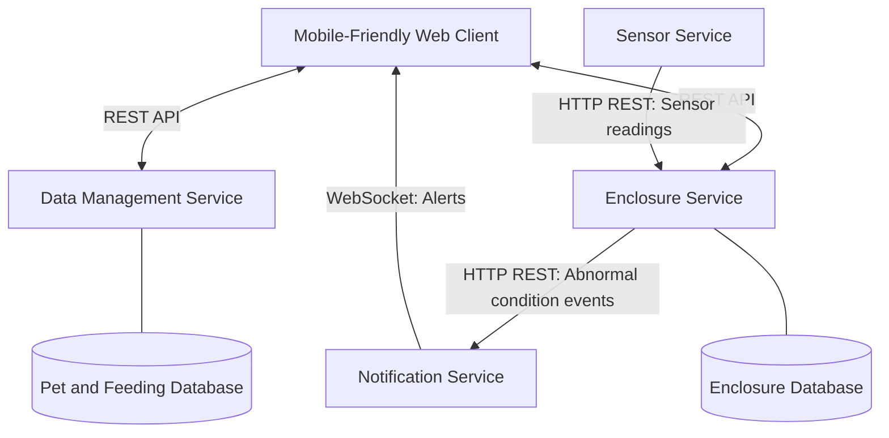
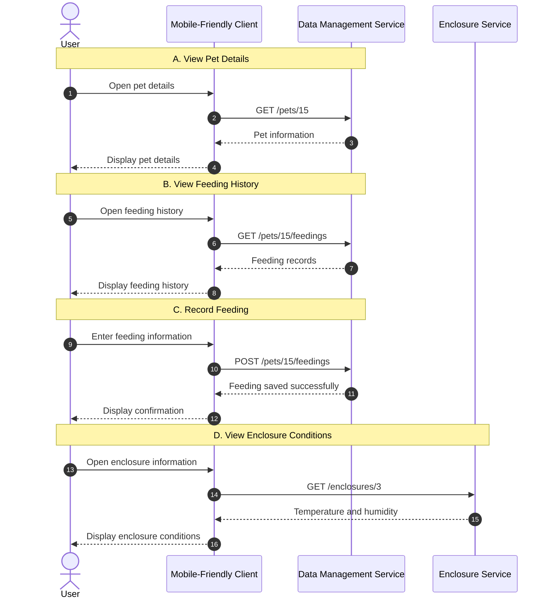
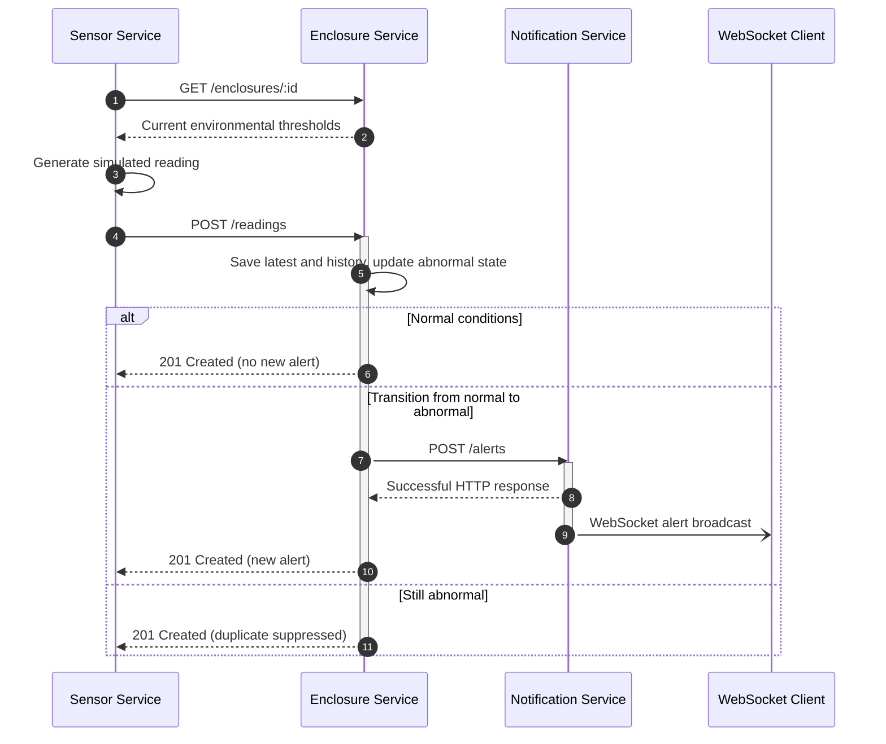

# Exotic Pet Keeper — System Architecture

## 1. Architecture Overview

Exotic Pet Keeper follows a microservice architecture
consisting of four independently running backend services
and one mobile-friendly web client.

Each microservice has a specific responsibility and
communicates with other components through defined APIs.

The system uses REST over HTTP for ordinary requests
and WebSocket for delivering real-time alerts.

## 2. Architecture Diagram

## 3. Component Responsibilities

### 3.1 Mobile-Friendly Web Client

Planned interface through which users will interact
with the application. The web client is not implemented yet.

Responsibilities:
- Display pet information.
- Add, edit, and delete pets.
- Record feeding events.
- Display feeding history.
- Display enclosure conditions.
- Display environmental history (planned).
- Receive real-time alerts.

### 3.2 Data Management Service

Manages pet information and feeding records.

Responsibilities:
- Store and retrieve pet information.
- Manage pet records.
- Record feeding events.
- Retrieve feeding history.

This service uses its own SQLite database.

### 3.3 Enclosure Service

Processes and stores enclosure measurements.

Responsibilities:
- Receive temperature and humidity readings.
- Store enclosure configurations and latest readings.
- Preserve timestamped history of simulated and manually entered measurements.
- Retrieve enclosure history by UTC date range with a configurable result limit.
- Compare readings against configured acceptable ranges.
- Detect abnormal environmental conditions.
- Send abnormal-condition events to the Notification Service only on normal-to-abnormal transitions.

This service uses a separate SQLite database.

### 3.4 Sensor Service

Runs as an independent Node.js process that simulates environmental
measurements for one configured enclosure at a time.

Responsibilities:
- Retrieve the enclosure's current temperature and humidity thresholds via REST.
- Generate repeatable normal, high-temperature, and low-humidity readings.
- Send measurements to the Enclosure Service via REST.
- Allow the enclosure ID and simulation delay to be configured through environment variables.
- Log failed requests and automatically resume communication when the Enclosure Service becomes available.

The Sensor Service does not expose an HTTP server, maintain a database,
or require physical sensors or additional npm packages.
It uses a five-second delay between completed cycles by default.

### 3.5 Notification Service

Handles the delivery of environmental alerts.

Responsibilities:
- Receive abnormal-condition events.
- Prepare notification messages.
- Send alerts to connected clients using WebSocket.

The Notification Service does not require persistent
storage for the initial implementation.

## 4. Communication Protocols

### 4.1 REST APIs

REST APIs are used for synchronous communication.

Examples:
- Client requests pet information from Data Management.
- Client records a feeding event in Data Management.
- Client requests environmental data from Enclosure.
- Sensor sends simulated measurements to Enclosure.
- Enclosure sends abnormal-condition events to Notification.

### 4.2 WebSocket

WebSocket provides a persistent connection between
the Notification Service and the client.

When the Enclosure Service detects a transition from normal to abnormal,
it sends an alert to the Notification Service, which broadcasts to connected clients.

Normal environmental readings do not generate alerts.

## 5. Environmental Monitoring

The Sensor Service periodically generates simulated
temperature and humidity measurements.

The Enclosure Service receives these measurements and
compares them against configured acceptable ranges.

Example acceptable ranges:
- Temperature: 22-28 degrees Celsius.
- Humidity: 60-75%.

### Normal Reading

Example:
- Temperature: 25 degrees Celsius.
- Humidity: 68%.

The Enclosure Service updates the latest reading and saves a historical
measurement. No notification is generated.

### Abnormal Reading

Example:
- Temperature: 31 degrees Celsius.
- Humidity: 42%.

The Enclosure Service detects values outside the
configured acceptable ranges.

The reading is saved to both latest-reading storage and history. If the
enclosure was previously normal, it sends an alert event to Notification,
which broadcasts a WebSocket message to connected clients. Continued
abnormal readings do not generate duplicate alerts. Manual historical
observations never change the current state or generate alerts.

## 6. Data Ownership

Each service is responsible for its own data.

- Data Management owns pet and feeding records.
- Enclosure owns enclosure configuration, latest readings, and environmental history.
- Sensor generates temporary simulated measurements.
- Notification processes alert events.

Services do not directly access each other's databases.

## 7. Design Decisions

The architecture deliberately uses four independent
microservices to demonstrate distributed communication.

REST provides simple and understandable request-response
communication.

WebSocket enables real-time alert delivery without
continuous client polling.

Simulated sensors remove the need for physical IoT
hardware while preserving the environmental monitoring
workflow.

Authentication, advanced statistics, and physical
sensor integrations are outside the project's scope.

## 8. Sequence Diagrams

Sequence diagrams illustrate how the components of the
system communicate during specific operations.

### 8.1 Normal Application Interactions

This scenario demonstrates how the user interacts
with the application to retrieve pet information,
view feeding history, record feeding events, and
check enclosure conditions.

### 8.2 Explanation

**A. View Pet Details**

The user opens the details of a selected pet.
The client sends a REST GET request to the Data
Management Service, which retrieves the pet
information and returns it to the client.

**B. View Feeding History**

The user requests the feeding history of a pet.
The Data Management Service retrieves the
corresponding feeding records and returns them.

**C. Record Feeding**

The user enters feeding information, such as
food description, date, and optional notes.

The client sends a REST POST request to the
Data Management Service, which saves the record
and confirms the operation.

**D. View Enclosure Conditions**

The user opens the enclosure information.
The client requests the latest environmental
readings from the Enclosure Service.

The Enclosure Service returns the stored
temperature and humidity measurements.

These operations use REST communication.
They do not generate real-time notifications.

### 8.3 Real-Time Environmental Monitoring

This sequence diagram describes the implemented Sensor → Enclosure →
Notification flow. A WebSocket client can receive broadcasts today; the
mobile-friendly application interface is planned.

If the Notification Service is unavailable, the Enclosure Service logs the
failure and preserves the reading. Alert delivery is not guaranteed.

### 8.4 Explanation of Environmental Monitoring

**Step 1 — Retrieve thresholds and generate a reading**

The Sensor Service requests the enclosure's configured ranges using
`GET /enclosures/:id`. It generates a normal or abnormal reading based on
those thresholds, then sends it to `POST /readings`.
The default delay between completed simulation cycles is five seconds;
`SENSOR_INTERVAL_MS` can configure another delay.

**Step 2 — Store and evaluate measurements**

The Enclosure Service validates the enclosure and measurement, retains the
latest values, appends a sensor-sourced history record, and updates the
current abnormal state in the same SQLite transaction.

**Step 3A — Normal conditions**

The reading is stored and no alert is generated. Returning to normal clears
the abnormal state so a subsequent abnormal reading can trigger a new alert.

**Step 3B — Newly abnormal conditions**

A transition from normal to abnormal triggers `POST /alerts` to the
Notification Service. If conditions remain abnormal, no duplicate alert is sent.

**Step 4 — WebSocket notification**

The Notification Service broadcasts the event to currently connected
WebSocket clients. The future web client will display the warning without a
page refresh. If the Notification Service is down, the reading remains stored.

### 8.5 Manual Historical Observation

A future web client will let a keeper enter an observation from a standalone
thermometer or hygrometer. The client sends temperature, humidity, and the
UTC observation time to `POST /enclosures/:id/readings/manual`. Enclosure
validates and stores it in history. Unlike an automated sensor reading, this
does not update the latest reading or current abnormal state and does not
contact Notification. The history endpoint can later retrieve these records
alongside automated measurements.

## 9. Implementation Status and Planned Improvements

The four backend microservices are implemented and have passed functional
integration tests, including simulated normal/abnormal readings, suppression
of repeated alerts, WebSocket broadcasts, and recovery after service downtime.

### 9.1 Environmental History and Manual Observations (Implemented — Milestone 9)

The Enclosure Service retains the latest sensor reading in `readings` and
preserves each successfully received sensor measurement in `reading_history`.
The history table also accepts manual observations, with their observation
time and a source of `manual` or `sensor`. Existing enclosure records are
preserved when the history table is first created.

- `POST /readings` updates the latest reading, appends a history row, and
  updates the abnormal state in a single transaction.
- `POST /enclosures/:id/readings/manual` adds a historical observation with
  an explicit UTC timestamp, without changing current state or alerts.
- `GET /enclosures/:id/readings/history` returns history ordered by
  observation time, with optional inclusive UTC dates (`from`, `to`) and a
  `limit` of 1–1000 (default 100).

Both measurement sources use the Enclosure Service's SQLite database; no
additional service or database is needed. Deleting an enclosure also deletes
its history through foreign-key cascading.

History is useful for comparing conditions with feeding dates, but automated
pet-specific comparisons require the pet-to-enclosure association described
below. Pagination, charts, and analytics are not yet implemented.

### 9.2 Mobile-Friendly Web Client (Planned)

The web client will allow users to manage pets, feeding records, and
enclosures, enter manual environmental observations, view current and
historical conditions, and receive real-time alerts.

### 9.3 Future Data Association

Pet records currently do not contain an enclosure reference. Associating a
pet with an enclosure will require an explicit design change before the
application can automatically compare an individual pet's feeding history
with that enclosure's environmental history.
