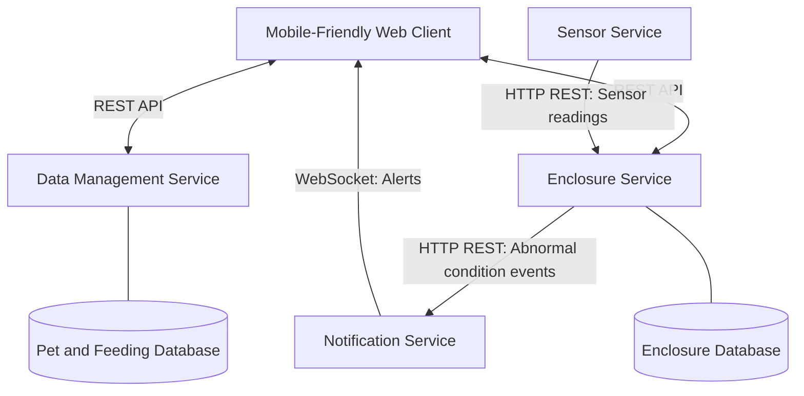
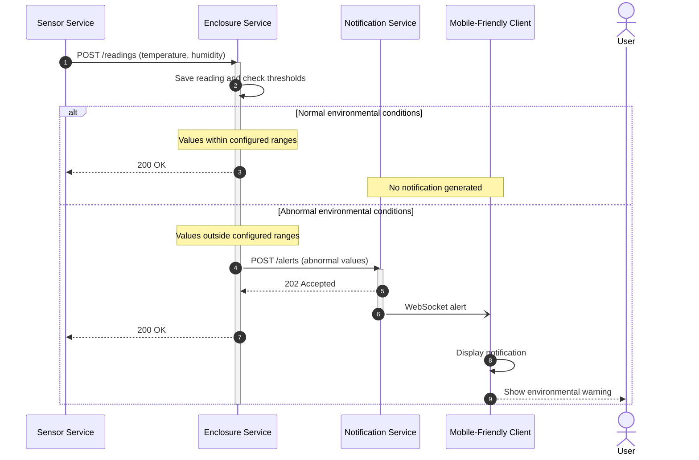

# Exotic Pet Keeper — System Architecture

## 1. Architecture Overview

Exotic Pet Keeper follows a microservice architecture
consisting of four independently running backend services
and one mobile-friendly web client.

Each microservice has a specific responsibility and
communicates with other components through defined APIs.

The system uses REST over HTTP for ordinary requests
and WebSocket for delivering real-time alerts.

## 2. Architecture Diagram

## 3. Component Responsibilities

### 3.1 Mobile-Friendly Web Client

Provides the interface through which users interact
with the application.

Responsibilities:
- Display pet information.
- Add, edit, and delete pets.
- Record feeding events.
- Display feeding history.
- Display enclosure conditions.
- Receive real-time alerts.

### 3.2 Data Management Service

Manages pet information and feeding records.

Responsibilities:
- Store and retrieve pet information.
- Manage pet records.
- Record feeding events.
- Retrieve feeding history.

This service uses its own SQLite database.

### 3.3 Enclosure Service

Processes and stores enclosure measurements.

Responsibilities:
- Receive temperature and humidity readings.
- Store enclosure configurations and latest readings.
- Compare readings against configured acceptable ranges.
- Detect abnormal environmental conditions.
- Send abnormal-condition events to the Notification Service.

This service uses a separate SQLite database.

### 3.4 Sensor Service

Simulates environmental sensor devices.

Responsibilities:
- Generate temperature and humidity measurements.
- Send measurements periodically to the Enclosure Service.
- Generate normal and abnormal values for testing.

The Sensor Service does not require physical hardware
or persistent storage for the initial implementation.

### 3.5 Notification Service

Handles the delivery of environmental alerts.

Responsibilities:
- Receive abnormal-condition events.
- Prepare notification messages.
- Send alerts to connected clients using WebSocket.

The Notification Service does not require persistent
storage for the initial implementation.

## 4. Communication Protocols

### 4.1 REST APIs

REST APIs are used for synchronous communication.

Examples:
- Client requests pet information from Data Management.
- Client records a feeding event in Data Management.
- Client requests environmental data from Enclosure.
- Sensor sends simulated measurements to Enclosure.
- Enclosure sends abnormal-condition events to Notification.

### 4.2 WebSocket

WebSocket provides a persistent connection between
the Notification Service and the client.

When an abnormal environmental condition is detected,
the Notification Service sends an alert to connected clients.

Normal environmental readings do not generate alerts.

## 5. Environmental Monitoring

The Sensor Service periodically generates simulated
temperature and humidity measurements.

The Enclosure Service receives these measurements and
compares them against configured acceptable ranges.

Example acceptable ranges:
- Temperature: 22-28 degrees Celsius.
- Humidity: 60-75%.

### Normal Reading

Example:
- Temperature: 25 degrees Celsius.
- Humidity: 68%.

The Enclosure Service stores the reading.
No notification is generated.

### Abnormal Reading

Example:
- Temperature: 31 degrees Celsius.
- Humidity: 42%.

The Enclosure Service detects values outside the
configured acceptable ranges.

It then sends an alert event to the Notification Service,
which delivers a WebSocket message to the client.

## 6. Data Ownership

Each service is responsible for its own data.

- Data Management owns pet and feeding records.
- Enclosure owns enclosure configuration and readings.
- Sensor generates temporary simulated measurements.
- Notification processes alert events.

Services do not directly access each other's databases.

## 7. Design Decisions

The architecture deliberately uses four independent
microservices to demonstrate distributed communication.

REST provides simple and understandable request-response
communication.

WebSocket enables real-time alert delivery without
continuous client polling.

Simulated sensors remove the need for physical IoT
hardware while preserving the environmental monitoring
workflow.

Authentication, advanced statistics, and physical
sensor integrations are outside the project's scope.

## 8. Sequence Diagrams

Sequence diagrams illustrate how the components of the
system communicate during specific operations.

### 8.1 Normal Application Interactions

This scenario demonstrates how the user interacts
with the application to retrieve pet information,
view feeding history, record feeding events, and
check enclosure conditions.

### 8.2 Explanation

**A. View Pet Details**

The user opens the details of a selected pet.
The client sends a REST GET request to the Data
Management Service, which retrieves the pet
information and returns it to the client.

**B. View Feeding History**

The user requests the feeding history of a pet.
The Data Management Service retrieves the
corresponding feeding records and returns them.

**C. Record Feeding**

The user enters feeding information, such as
food type, quantity, and date.

The client sends a REST POST request to the
Data Management Service, which saves the record
and confirms the operation.

**D. View Enclosure Conditions**

The user opens the enclosure information.
The client requests the latest environmental
readings from the Enclosure Service.

The Enclosure Service returns the stored
temperature and humidity measurements.

These operations use REST communication.
They do not generate real-time notifications.

### 8.3 Real-Time Environmental Monitoring

This sequence diagram illustrates how simulated sensor
readings are processed and how the system responds to
normal and abnormal environmental conditions.

### 8.4 Explanation of Environmental Monitoring

**Step 1 — Generate Sensor Readings**

The Sensor Service generates simulated temperature
and humidity measurements periodically.

For example, every five seconds it sends an HTTP POST
request to the Enclosure Service.

The readings include an enclosure identifier so the
Enclosure Service knows which enclosure they belong to.

**Step 2 — Store and Validate Measurements**

The Enclosure Service receives the measurements,
stores the latest values, and compares them against
the configured acceptable ranges for that enclosure.

**Step 3A — Normal Environmental Conditions**

If both temperature and humidity are within their
acceptable ranges, the Enclosure Service returns
a successful response to the Sensor Service.

The Notification Service is not contacted.

**Step 3B — Abnormal Environmental Conditions**

If either temperature or humidity is outside its
configured range, the Enclosure Service creates
an alert event containing information about the
abnormal condition.

The alert is sent to the Notification Service
using an HTTP POST request.

**Step 4 — Real-Time Notification**

The Notification Service accepts the alert event
and sends a WebSocket message to connected clients.

The mobile-friendly client displays the warning
to the user without requiring a page refresh.

## 9. Future Implementation Considerations

The initial implementation will focus on the
successful communication flows described above.

Additional details to address during implementation:

- Avoid sending duplicate alerts continuously.
- Handle unavailable services and failed HTTP requests.
- Validate incoming sensor measurements.
- Associate readings with the correct enclosure.
- Handle disconnected WebSocket clients.

These mechanisms will be implemented without adding
extra microservices or expanding the project scope.
